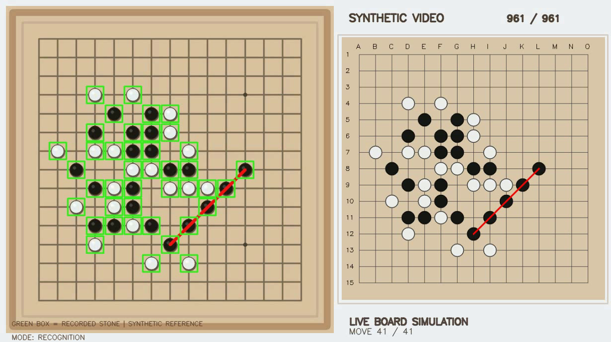

# GomokuVision

> ⭐ If this educational project helps your learning or research, consider giving it a **Star**. Suggestions, reproducible bug reports, and contributions are welcome.

**MATLAB · Python / OpenCV · C# / OpenCvSharp · Windows WPF · Browser-based Replay**

GomokuVision began as a **2025 university final course assignment** titled *Design and Implementation of a Real-Time Gomoku Board Recognition and Prediction System* (「即時五子棋棋盤辨識與預測系統之設計與實現」). In **November 2026**, the original MATLAB-based idea was modernized into a more complete, cross-language computer vision technical demonstration.

The project is shared for **educational use, technical exchange, and reproducible engineering experiments**. It is **not** a claim of commercial readiness or general real-world video recognition accuracy.

[繁體中文 / Traditional Chinese](#繁體中文--traditional-chinese) · [Browser Replay](index.html) · [Windows benchmark evidence](docs/benchmarks/WINDOWS_V039_36_CASE_EVIDENCE.md) · [Timing methods](docs/benchmarks/TIMING_METHODS.md) · [Download Release](https://github.com/hom-line/GomokuVision/releases/tag/GomokuVision) · [Changelog](CHANGELOG.md)



## Project at a glance

| Feature | Implementation |
|---|---|
| Recognition engines | MATLAB (Image Processing Toolbox), Python/OpenCV, C#/OpenCvSharp |
| Desktop interface | Windows WPF (.NET 10), English-first default + Traditional Chinese |
| Browser interface | **Static Web Replay** with synchronized synthetic video, 15×15 board, move history and benchmark chart; does **not** run live recognition |
| Recognition modes | Separate black/white ROI or shared ROI; confirmed-stone boxes or recognition + heuristic suggestions |
| Playback | Single synchronized video/board timeline, 1× / 2× / 4× |
| Test automation | 12/24/36 configurations and CSV/JSON exports |
| Reproducible demo | One self-authored 961-frame / 41-move, 30 FPS synthetic video |

## Source video assets and browser demo

GitHub stores the four original 961-frame self-rendered MP4 videos in **lossless `.mp4.xz` archives** to preserve the exact bytes of the tested V0.3.9 videos while keeping Git transport small. Restore them once after cloning:

```powershell
python python/tools/restore_demo_videos.py --verify
```

The script verifies the original SHA-256 before placing each MP4 in `demo/full_game/`; existing matching files are left unchanged. WPF startup can restore the primary video automatically if Python is installed. The static [Web Replay](index.html) uses `full_game_961_web.mp4`, a separate browser-friendly H.264 encoding with the same **961-frame / 30 FPS** timeline and 41-move reference. It is a **visual replay**, not a fresh engine inference or a substitute for benchmark video SHA matching.

## 📥 Download and quick start

The first source-release baseline is **`v0.3.9`**, published under the existing [GomokuVision Release](https://github.com/hom-line/GomokuVision/releases/tag/GomokuVision). Repository and README titles remain just **GomokuVision**. For local validation, clone or extract the source archive and run:

```powershell
.\scripts\Verify-WPF-Build-Windows.bat
.\Launch-Desktop-Windows.bat
```

Requirements: **Windows x64, .NET 10 SDK** for WPF/C#, and Python 3.10+ plus `python/requirements.txt` for Python. The MATLAB engine is optional and requires a **separately licensed MATLAB + Image Processing Toolbox**. This is a **source build**, not a prebuilt standalone EXE.

The default input is the self-generated `demo/full_game/full_game_961.mp4`. Choose an engine, ROI and display mode. For the full matrix, select 1×, 2× and 4× in **Batch benchmark → CSV export**. Each combination is processed independently and exports detailed CSV, summary CSV and metadata JSON.

### 🌐 Browser replay / Web UI

Open [`index.html`](index.html) locally or serve the repository root using GitHub Pages. It includes synchronized MP4 and board playback, previous/next move, seek bar, 1×/2×/4× controls, green reference boxes, a 41-move log, and a summary of the measured three-language benchmark.

**Scope note:** This web page replays the **known synthetic reference timeline**. It does not execute the actual MATLAB, Python, or C# recognition engines in a browser and does not claim that the synthetic annotations are independently detected results. The Windows WPF application is the recognition interface.

## 🧪 Verified Windows results — November 8, 2026

**36 / 36 PASS** with 0 failed/skipped across **3 engines × 2 ROI strategies × 2 overlay modes × 3 playback labels**. All 36 runs used the same synthetic 961-frame video, analyzed 161 frames and matched 41 moves / Black winner.

| Engine | Detection & move commit | In-process pipeline | Entire process |
|---|---:|---:|---:|
| C# / OpenCvSharp | 1.010 s | 1.821 s | 1.929 s |
| Python / OpenCV | 1.377 s | 2.830 s | 2.988 s |
| MATLAB | 1.363 s | 8.909 s | 21.889 s |

[36 individual results](docs/benchmarks/windows_v039_36_case_results_2026-11-08.csv) · [Engine averages](docs/benchmarks/windows_v039_engine_summary.csv) · [Verification details](docs/benchmarks/WINDOWS_V039_36_CASE_EVIDENCE.md)

**Fair comparison:** Full-process time includes MATLAB interpreter startup, whereas detection-core timing excludes decoding, encoding, visualization and process startup for **all three engines**. Do not compare the MATLAB end-to-end time with another engine's detection-only time. These are one test run per configuration, not statistically independent repetitions.

**1×, 2× and 4× are playback labels**, not detection acceleration. All tests use one synthetic video and do not establish general recognition accuracy. See [methodology](docs/benchmarks/TIMING_METHODS.md) for scope and limitations.

## 🧩 Source layout

```text
GomokuVision/
├── index.html, web/             Browser-based synchronized replay
├── csharp/GomokuVision/         C# independent recognition engine
├── csharp/GomokuVision.Desktop/ Windows WPF application
├── python/gomoku/, tools/      Python engine, generators, benchmark tooling
├── matlab/modern/              Independent MATLAB engine and tests
├── demo/full_game/             Self-rendered synthetic inputs and videos
├── docs/benchmarks/            Sanitized Windows results and methods
├── scripts/                    Windows build / validation entry points
├── docs/releases/              Release history, notes and publication documents
└── .github/workflows/          Automated CI definition
```

The **2025 legacy MATLAB source files are excluded from this publication-preparation archive pending confirmation of all original contributors' publication rights**. The contemporary MATLAB implementation in `matlab/modern/` is included, so all three language engines are represented. Historical third-party video footage is also excluded. No personal user input files or private test logs are included.

## 🔧 Development and verification

```bash
python -m pip install -r python/requirements-dev.txt
PYTHONPATH=python python -m pytest -q python/tests
```

Windows full matrix: run `scripts/Run-Selected-Speeds-Windows.bat` and select one or more playback labels. See live [GitHub Actions CI results](https://github.com/hom-line/GomokuVision/actions) for current Python and Windows verification.

## ⚖️ Licensing and sharing

The owner has confirmed that the **modern MATLAB, Python and C# project source and self-generated demonstration assets** are original works the owner is authorized to publish under the [MIT License](LICENSE). This license **does not relicense** MATLAB, OpenCV, OpenCvSharp, .NET or other third-party dependencies; see [THIRD_PARTY_NOTICES.md](THIRD_PARTY_NOTICES.md). The historical 2025 course MATLAB files and original third-party footage are excluded from this repository.

## 🗺️ Roadmap

- **Initial public baseline (`v0.3.9`):** three engines, WPF, offline/Pages browser replay, synthetic 36-case Windows evidence.
- **Next:** self-contained Windows release asset, verified GitHub Actions, and browser-based acceptance on GitHub Pages.
- **Future research:** real-camera dataset, automatic four-corner calibration, occlusion recovery, tactical search and real-time capture.

**Maintainer:** [`hom-line`](https://github.com/hom-line) · **Original project:** course final assignment (2025) · **Modernization:** November 2026.

## License

Project-authored modern source and original synthetic demo assets are released under the [MIT License](LICENSE). See [third-party notices](THIRD_PARTY_NOTICES.md). Proprietary MATLAB/toolboxes are not included.

---

## 繁體中文 / Traditional Chinese

**MATLAB · Python · C# 三語言五子棋棋盤辨識與棋步預測 — 技術分享專案**

本專案起源於 **2025 年大學課程期末作業**「即時五子棋棋盤辨識與預測系統之設計與實現」，原本以 MATLAB 為主要開發工具。**2026 年 11 月**在保留原始技術構想的基礎上，擴充為 Python/OpenCV、C#/OpenCvSharp、MATLAB 三套辨識程式，並新增 Windows WPF 介面、同步影片棋盤重播、綠色辨識框、落子預測及一鍵 CSV 效能比較。

本專案定位為**教育用途、工程實作、技術交流與研究方法分享**，不宣稱已通過所有真實攝影場景的準確率驗證。

[English overview](#gomokuvision) · [瀏覽器棋局重播](index.html) · [Windows 36 組測試證據](docs/benchmarks/WINDOWS_V039_36_CASE_EVIDENCE.md) · [三層計時方法](docs/benchmarks/TIMING_METHODS.md)


## 功能

可從 GitHub clone 原始碼，使用 `python python/tools/restore_demo_videos.py` 還原四支經無損壓縮的自製 MP4；Web Replay 使用同影格時間軸的 H.264 輕量版。

- **三個獨立辨識引擎**：C#、Python、MATLAB（MATLAB 需要正版授權及 Image Processing Toolbox）。
- **Windows WPF**：英文預設、可切換繁體中文，支援兩種 ROI、純辨識與辨識加預測。
- **影音棋盤同步**：961 幀自製完整棋局、41 手、1×／2×／4× 播放，棋譜、影片和棋盤同步。
- **Web UI**：可直接開啟 `index.html`，以瀏覽器同步重播自製影片、瀏覽棋譜和測試圖表。**網頁本身不執行 MATLAB、Python、C# 辨識。**
- **自動化測試**：三引擎 × 二種 ROI × 二種畫面模式 × 三種播放倍率，合計 36 種組合，CSV 匯出。

## 使用方式

Windows x64 安裝 .NET 10 SDK、Python 3.10+ 與所需套件，解壓專案後執行：

```powershell
.\scripts\Verify-WPF-Build-Windows.bat
.\Launch-Desktop-Windows.bat
```

若要跑 MATLAB 引擎，需另外安裝取得授權的 MATLAB 與 Image Processing Toolbox。這是**原始碼版本**，不是免安裝 EXE。

## 2026/11/08 Windows 實測

全部 **36/36 PASS**，每組皆是 961 幀來源、161 個分析影格、41 手、黑棋獲勝。三引擎不同層級的平均時間如下：

| 引擎 | 核心辨識＋落子 | 引擎內總處理 | 整個程序 |
|---|---:|---:|---:|
| C# | 1.010 秒 | 1.821 秒 | 1.929 秒 |
| Python | 1.377 秒 | 2.830 秒 | 2.988 秒 |
| MATLAB | 1.363 秒 | 8.909 秒 | 21.889 秒 |

請注意 MATLAB 的完整耗時包含程序外部成本；播放倍率不是演算法加速倍率。本測試使用**同一部自行生成的 961 幀影片**，並非 36 部不同影片，更不能宣稱真實場景辨識準確率 100%。

## 版權及公開範圍

2025 年課程歷史 MATLAB 原始檔，因共同作者與原始權利尚未確認，**暫不列入這份對外發布準備包**；保留現代化 MATLAB 引擎，所以三語言架構不受影響。原始第三方影片也沒有公開。

**作者已確認現代版原始碼及自製素材權利，並同意依 MIT License 開源。** 第三方元件仍依各自授權；2025 年歷史 MATLAB 程式與原始第三方影片不在公開範圍。

維護者：[`hom-line`](https://github.com/hom-line) · 原始專題：2025 年期末作業 · 現代化升級：2026 年 11 月。GitHub README 主標題只用 **GomokuVision**；`v0.3.9` 是首次發布版本號，現有 GitHub Release 標籤為 `GomokuVision`。

## 授權

本次現代版自有原始碼與自製合成示範素材採用 [MIT License](LICENSE)；依賴的第三方元件、MATLAB 執行環境及原始第三方影片不在此授權範圍。詳見 [第三方聲明](THIRD_PARTY_NOTICES.md)。
